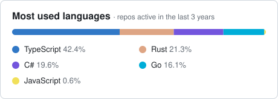

# Hi, I'm Lucas 👋🏼

Full-Stack Developer with 6 years of experience building web, mobile and backend applications across Brazilian and international teams. Currently working with **C#/.NET, TypeScript, React, React Native and Go**.

  
  

## Main Stack

  
  &nbsp;
  
  &nbsp;&nbsp;
  
  &nbsp;&nbsp;
  
  &nbsp;&nbsp;
  
  &nbsp;&nbsp;
  
  &nbsp;&nbsp;

## Latest fun projects

| Project | What it is | Built with |
| --- | --- | --- |
| [**Proximus**](https://github.com/lucastafer/proximus) | Local-first desktop app to monitor Linux servers and Docker containers over SSH. No agents, no telemetry. | Rust, Tauri, React |
| [**OMIGo**](https://github.com/lucastafer/OMIGo) | Lightweight app for batch-converting images to optimized WebP. | Go |
| [**RagForge**](https://github.com/lucastafer/RagForge) | Compact Retrieval-Augmented Generation API that works with any OpenAI-compatible provider. | C#, .NET, PostgreSQL |

## Current Focus

- Advanced Golang Concepts & LeetCode
- Nostr & Bitcoin/Lightning solutions

## Languages Across My Repos

<picture>
  <source media="(prefers-color-scheme: dark)" srcset="assets/languages-dark.svg" />
  
</picture>
